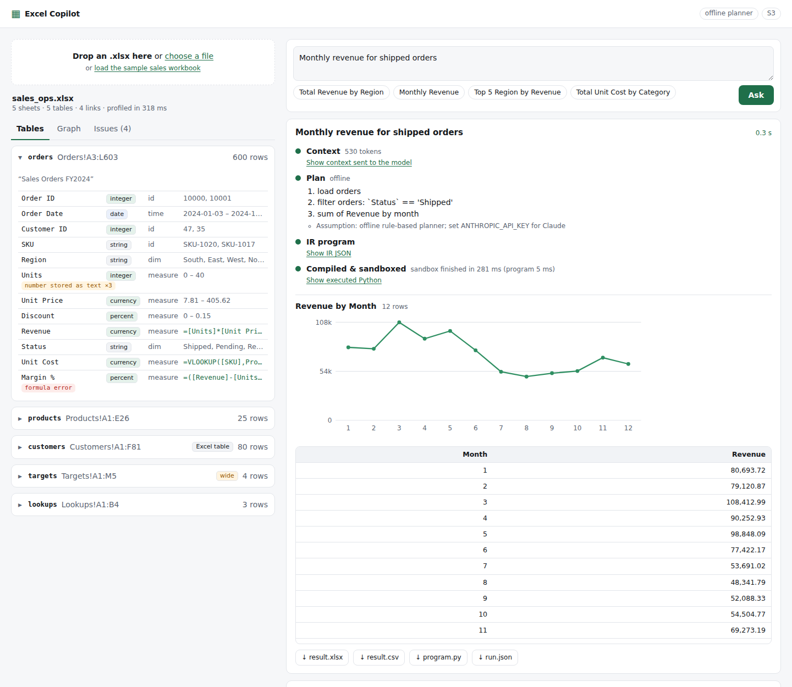
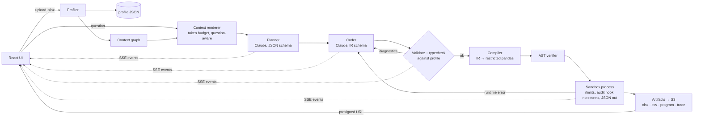

# ai-excel-copilot

Ask questions about an Excel workbook in plain English and get answers you can audit.

The system profiles a workbook into typed JSON and a compact **context graph**, has
Claude **plan** an answer and then **write a program in a small validated IR** (not
Python), **compiles** that IR into restricted pandas, runs it in a **sandboxed
subprocess**, and streams every stage to a React UI over server-sent events. Results
come back as a formatted `.xlsx` with a provenance sheet, a CSV, the executed program,
and a full JSON trace, all served from S3 through short-lived presigned URLs. It runs
locally with one command, and deploys to AWS as API Gateway (REST, response
streaming) → Lambda (container + Web Adapter) → S3, with the UI on CloudFront.



## How a question flows



### 1. Profiler (`backend/excel_copilot/profiler/`)

Real workbooks rarely start with a clean header at A1. The profiler:

- **Opens defensively.** The zip container is checked before openpyxl parses it:
  signature, entry count, path traversal, total expanded size and compression ratio
  (zip bombs), and presence of `xl/workbook.xml`. Macros are detected and never run;
  external links are flagged.
- **Finds tables.** Excel Tables (ListObjects) are taken as ground truth. The
  remaining cells are grouped into 8-connected regions; each region's header row is
  located (skipping title rows), and a lone text cell above a region becomes its title.
  Leftover single cells become "notes" (e.g. an FX rate parameter). Wide layouts
  (Jan..Dec, 2021..2024, Q1..Q4 as columns) are detected.
- **Types and profiles every column**: integer/number/currency/percent (from the
  number format), date/datetime, boolean, string. It records type confidence, nulls,
  distinct counts, numeric stats, date ranges, top values, a role (id, measure,
  dimension, time, text, flag), and data-quality issues: numbers stored as text, Excel
  error values (`#DIV/0!`, with cell address), mixed types, blank and duplicate
  headers, merged cells inside tables, formulas with no cached values.
- **Understands formulas.** Filled-down formulas are normalised relative to their row
  (`=F4*G4` on row 4 → `=F{r}*G{r}`) using openpyxl's tokenizer, coverage is measured,
  and they are rendered with column names: `=[Units]*[Unit Price]*(1-[Discount])`.
- **Infers relationships**: VLOOKUP/XLOOKUP formulas become `formula_lookup` edges,
  and value containment plus name similarity gives `foreign_key` edges with a measured
  match rate. The demo's two orphan customer IDs show up as 97.6%.
- **Detects PII** (email, phone, SSN-like, Luhn-valid card numbers). Samples are
  redacted, and raw PII never reaches the LLM context.

### 2. Context graph (`graph.py`)

`build_graph` turns the profile into nodes (workbook, sheets, tables, columns, named
ranges) and edges (`contains`, `foreign_key`, `formula_lookup`, `derived_from`,
`references`) for downstream pipelines. `render_context` writes a dense text view for
the LLM under a **token budget**. Tables are ranked by relevance to the question
(lexical overlap with names and categorical values, plus a bonus for join neighbours).
Detail is then cut in a fixed order: unrelated tables shrink to one line, relevant
tables lose stats evenly, and unrelated tables are dropped. For the demo workbook, the
full profile JSON is about 5,900 tokens and the complete context is about 530.

### 3. Planner → coder → IR (`llm/`, `ir/`)

Both stages call Claude through `client.messages.parse(output_format=PydanticModel)`,
which sends the JSON schema as `output_config.format` so decoding is **constrained** to
the schema. The workbook context goes in a cached system block (`cache_control`), so
follow-up questions on the same workbook read it from the prompt cache.

The IR was designed around the limits of constrained decoding:

- It is flat (no recursive schemas), has no `discriminator`, and every field is required.
- Single-value literals are emitted as one-item `enum`s. The SDK moves `const` into
  the description, where it is *not* enforced, and a test pins this behaviour.
- Expressions are short strings in a small formula language: `` `Order Date` >=
  '2024-07-01' and Region in ['West','East'] ``, `if_else(Units > 0, Revenue / Units,
  0)`. They are parsed with an allowlist over Python's `ast` and **type-checked**
  against the frame schema, which is tracked step by step.

There are ten operations: `load filter derive select aggregate join sort limit unpivot
pivot`. The validator rejects unknown tables and columns (with "did you mean" hints),
type errors, summing identifier columns, mismatched join key types, undefined frames
and charts over non-numeric columns. Its diagnostics go straight back to the coder.
There are up to two repair rounds for validation errors, plus one for runtime errors
(e.g. a many-to-many join explosion).

### 4. Compiler, verifier, sandbox (`ir/compiler.py`, `sandbox/`)

The compiler is deterministic. Every LLM-supplied string is emitted through `repr()`,
and the output is one `run(tables)` function of single assignments calling pandas
methods and a small helper library (`xl.div` returns missing values instead of ∞,
like Excel's `#DIV/0!`). The output is then checked by an **AST verifier** (allowlisted
nodes, names, attributes and helpers; no dunder access, imports or bare calls) and
executed in a **separate `python -I` process** with:

- a scrubbed environment (no API keys, no AWS credentials);
- `RLIMIT_AS`, `RLIMIT_CPU`, `RLIMIT_FSIZE=0` and `RLIMIT_NPROC=0`;
- a PEP 578 **audit hook**, installed after pandas warms up, that blocks sockets,
  subprocesses, `os.system/exec/fork`, ctypes, file writes, non-module file reads and
  any further `compile`/`exec`;
- a near-empty `__builtins__`;
- results returned as JSON on stdout (never unpickled in the parent), with a size cap.

The test suite turns the verifier **off** and confirms that the runtime layers still
stop `import os`, `open()`, `pd.read_csv('/etc/passwd')`, a request to the EC2
metadata endpoint, `to_csv`, `DataFrame.eval`, an infinite loop and a 1-billion-row
allocation. This is defence in depth, not a VM. On Lambda, the Firecracker microVM and
an IAM role scoped to one bucket form the outer boundary.

### 5. API and streaming (`api/app.py`)

FastAPI exposes upload/profile/graph/context endpoints, `POST /v1/workbooks/{id}/ask`
(a `text/event-stream` of `stage, context, plan, ir, diagnostics, code, log, result,
artifact, done | error`), and short-lived artifact links: S3 presigned GETs with
`Content-Disposition: attachment`, or HMAC-signed local links in development. It also
has optional API-key auth (constant-time compare), upload size and type limits,
ID/key validation against path traversal, security headers, structured request logs,
and an LRU of profiled workbooks.

The ask endpoint is a sync generator, so Starlette runs the blocking LLM calls and the
sandbox in a worker thread. Over real HTTP, through uvicorn and through the Vite
proxy, the `code` event arrived at about 9 ms and the `result` at about 360 ms, so the
stream is incremental, not buffered.

### 6. AWS (`infra/`, AWS CDK in Python)

- **API Gateway REST API with `ResponseTransferMode: STREAM`**, which uses Lambda's
  `InvokeWithResponseStreaming`. AWS added this in Nov 2025. Before that, streaming
  SSE from Lambda meant Function URLs or WebSockets. The endpoint is regional
  (edge-optimised streams have a 30 s idle timeout), with stage throttling and a 5-minute
  integration timeout.
- **Lambda container image** built from the same Dockerfile as local (`--target
  lambda`), with the **AWS Lambda Web Adapter** in `response_stream` mode, so the
  FastAPI app runs unchanged.
- **S3 artifacts bucket**: private, SSE, TLS-only, with lifecycle expiry for runs and
  uploads. The **Claude key** is read from Secrets Manager at cold start and never
  stored in the template.
- **UI** on S3 + CloudFront (Origin Access Control). `config.json` is written at deploy
  time with the API URL, so one build serves any stage.

## Run it

```bash
make install                       # backend (pip -e) + frontend (npm ci)
make dev-api                       # FastAPI on :8000 (offline planner unless ANTHROPIC_API_KEY is set)
make dev-ui                        # Vite on :5173, proxying /v1 to the API
```

With Claude:

```bash
export ANTHROPIC_API_KEY=sk-ant-...
export EXCEL_COPILOT_MODEL=claude-sonnet-5        # optional; EXCEL_COPILOT_CODER_MODEL overrides the coder stage
```

Full local stack with MinIO standing in for S3: `docker compose up --build`, then open
http://localhost:8088.

Deploy to AWS:

```bash
aws secretsmanager create-secret --name excel-copilot/anthropic-api-key --secret-string "$ANTHROPIC_API_KEY"
cd frontend && npm run build && cd ../infra && pip install -r requirements.txt
cdk deploy -c account=<id> -c region=us-east-1
```

### CLI

```bash
excel-copilot profile examples/sales_ops.xlsx [--json]
excel-copilot context examples/sales_ops.xlsx -q "revenue by segment" --budget 350
excel-copilot ask examples/sales_ops.xlsx "Average discount by customer segment" --out runs/
excel-copilot eval evals/sales_ops.json --llm offline|claude
```

### Configuration

| Variable | Meaning |
|---|---|
| `ANTHROPIC_API_KEY` / `ANTHROPIC_SECRET_ARN` | Claude key, or a Secrets Manager ARN to load it from (Lambda) |
| `EXCEL_COPILOT_LLM` | `claude`, `offline` or `auto` (default: Claude if a key is present) |
| `EXCEL_COPILOT_MODEL`, `EXCEL_COPILOT_CODER_MODEL` | model IDs (default `claude-sonnet-5`) |
| `ARTIFACT_BUCKET`, `ARTIFACT_PREFIX` | use S3 for uploads and artifacts (otherwise `LOCAL_STORAGE_DIR`) |
| `S3_ENDPOINT_URL`, `S3_PUBLIC_ENDPOINT_URL` | MinIO/LocalStack endpoint, and the host browsers use for presigned URLs |
| `API_KEYS`, `CORS_ORIGINS`, `MAX_UPLOAD_MB` | comma-separated API keys, allowed origins, upload limit |

## Sample output (pasted from real runs)

The demo workbook (`backend/examples/make_demo_workbook.py`) is deliberately messy. It
has a title row above the header, filled-down formulas including a cross-sheet
VLOOKUP, a `#DIV/0!`, three numbers stored as text, two orphan customer IDs, an Excel
Table with emails, a wide month-by-region targets sheet, a named range and a hidden
sheet. It is recalculated with LibreOffice, so cached values exist the way they would
in a file saved by Excel.

```
$ excel-copilot profile examples/sales_ops.xlsx
sales_ops.xlsx: 5 sheets, 5 tables, profiled in 259 ms

  orders       Orders!A3:L603      600 rows  detected
    Order ID         integer   identifier
    Order Date       date      temporal
    Customer ID      integer   identifier
    SKU              string    identifier
    Region           string    dimension
    Units            integer   measure     !number_stored_as_text
    Unit Price       currency  measure
    Discount         percent   measure
    Revenue          currency  measure    =[Units]*[Unit Price]*(1-[Discount])
    Status           string    dimension
    Unit Cost        currency  measure    =VLOOKUP([SKU],Products!$A$2:$E$26,4,FALSE())
    Margin %         percent   measure    =([Revenue]-[Units]*[Unit Cost])/[Revenue] !formula_error
  ...
  relationships
    orders.Region -> targets.Region  foreign_key containment=100.0%
    orders.Status -> lookups.Status  foreign_key containment=100.0%
    orders.SKU -> products.SKU  formula_lookup containment=100.0%
    orders.Customer ID -> customers.Customer ID  foreign_key containment=97.6%

  workbook issues: sheet 'Lookups' is hidden
```

The context under a 350-token budget. Relevant tables keep their types and join keys,
the rest collapse to one line, and emails never appear:

```
$ excel-copilot context examples/sales_ops.xlsx -q "total revenue by customer segment" --budget 350
WORKBOOK sales_ops.xlsx: 5 sheets, 5 tables; hidden sheets: Lookups
TABLE customers [Customers!A1:F81] 80 rows
  Customer ID: integer id unique
  Name: string text
  Email: string text
  Segment: string dim {Consumer, Enterprise, SMB}
  Country: string dim {US, DE, GB, CA}
  Signup Date: date time 2021-02-08..2023-09-24
TABLE orders [Orders!A3:L603] 600 rows "Sales Orders FY2024"
  Order ID: integer id unique
  Order Date: date time
  Customer ID: integer id -> customers.Customer ID
  SKU: string id ~> products.SKU
  Region: string dim -> targets.Region
  Units: integer measure
  ...
TABLE products [Products!A1:E26] 25 rows cols: SKU, Product Name, Category, Unit Cost, List Price
TABLE targets [Targets!A1:M5] 4 rows WIDE cols: Region, Jan, Feb, Mar, Apr, May, Jun, Jul, Aug, Sep, Oct, Nov...
TABLE lookups [Lookups!A1:B4] 3 rows cols: Status, Counts As Sale
NAME FX_EUR_USD = Targets!$B$8 (1.09)
NOTE Targets: A8=EUR/USD, B8=1.09
(detail reduced to fit; ask for a table to see it in full)

[337 tokens est., budget 350; detail levels {'orders': 1, 'products': 0, 'customers': 2, 'targets': 0, 'lookups': 0}]
```

A question end to end, using the offline planner:

```
$ excel-copilot ask examples/sales_ops.xlsx "Average discount by customer segment"
· context: 530 tokens
· plan:
    - load orders
    - join orders to customers
    - mean of Discount by Segment
    assumption: offline rule-based planner; set ANTHROPIC_API_KEY for Claude
· compiled program:
    def run(tables):
        base = tables['orders'].copy()
        customers_t = tables['customers'].copy()
        joined_1 = xl.join(base, customers_t, ['Customer ID'], ['Customer ID'], 'left')
        agg_2 = xl.aggregate(joined_1, ['Segment'], [('Discount', 'mean', 'Mean Discount')])
        sorted_3 = agg_2.sort_values(by=['Mean Discount'], ascending=[False], na_position='last', kind='stable')
        return sorted_3
· sandbox finished in 372 ms (program 22 ms)

Mean Discount by Segment  (4 rows)
   Segment  Mean Discount
       SMB         0.0526
  Consumer         0.0484
Enterprise         0.0385
 (missing)         0.0000
```

The `(missing)` row is the two orphan orders. The left join keeps them, which is the
honest answer.

## Evaluation

`evals/sales_ops.json` holds 12 questions, each paired with a hand-written reference
IR program. References run through the same compiler and sandbox. An answer passes
when every reference column is matched by an answer column with the same values and
the rows line up. Column names don't matter, and placeholder labels such as
"Unknown" or "Unmatched" count as a missing key.

Some questions have more than one defensible answer, so they carry labelled
**alternative references**. The report records which reading the answer matched.
Each alternative was added only after a live run produced that reading with a stated
assumption:

- *sales only*: the workbook has a hidden Lookups sheet with a "Counts As Sale" flag,
  and Claude applies it to exclude Pending and Returned orders from revenue;
- *inner join*: drops the two orders whose Customer ID is not in Customers.

### Claude (`claude-sonnet-5`, live API, run from macOS)

A fresh live run on the final pipeline code:

```
$ excel-copilot eval evals/sales_ops.json --llm claude
PASS  rev_by_region              13.87s     362 in  1462 out  ok (sales only: ...)
PASS  top5_sku_q3                32.55s    1826 in  4505 out  ok (sales only: ...)
PASS  avg_discount_segment       10.08s     364 in  1171 out  ok (drops the 2 orders whose Customer ID is not in Customers)
PASS  customers_by_region_2024   12.54s     401 in  1271 out
PASS  monthly_shipped            14.51s     398 in  1687 out
PASS  top_category               18.15s     450 in  2219 out  ok (sales only: ...)
PASS  returned_count             12.00s     725 in  1292 out
PASS  median_price_not_returned  11.20s     747 in  1334 out
PASS  orders_by_country          10.34s     367 in  1228 out  ok (drops the 2 orders whose Customer ID is not in Customers)
PASS  profit_by_category         27.58s     778 in  3376 out  ok (sales only: ...)
PASS  actual_vs_target_q1        27.80s     706 in  3741 out  ok (sales only: ...)
FAIL  enterprise_share           29.61s     631 in  3743 out  no answer column matches expected column 'Share'

11/12 passed (92%)
```

Token counts are uncached input and output across both stages and any repairs. The
workbook context is read from the prompt cache after the first call.

The one failure was again the grader. Claude computed the Enterprise share under the
sales-only reading: 26.6% of shipped revenue, against 28.4% of all revenue. It stated
that assumption in its plan. That case now has the same sales-only alternative as the
other revenue questions, and the run's recorded programs replay at **12/12**. That is
the same programs re-executed, not another live run.

On the same question set, Claude chose the sales-only reading in some runs and not in
others. That variability is why the alternatives are labelled and reported rather
than hidden.

### What the live runs found (and what changed because of them)

| Run | Result | Root cause | Fix |
|---|---|---|---|
| 1 | sandbox exit code 1 | macOS rejects `RLIMIT_AS`, and the child died before reporting | limits applied best-effort (`RLIMIT_DATA` fallback); child stderr surfaced |
| 2 | 0/12, HTTP 400 | "compiled grammar is too large": a 10-way `anyOf` step union | flat wire format for the coder (3.2 KB schema, no unions) plus a validated-JSON fallback |
| 3–4 | 5/12, 6/12 | key too strict (two valid readings); one program computed a top-1 limit but output the frame before it | alternative references; a discarded final step is now a validation error that triggers repair |
| 5 | crash | the compiler indexed an empty schema downstream of a rejected step | downstream steps skipped, only the root cause reported, eval isolates crashes |
| 6 | 10/12 → 12/12 replayed | grader: placeholder labels, profit reading | above |
| 7 | **11/12** live → 12/12 replayed | grader: Enterprise share under the sales-only reading | sales-only alternative |

### Offline rule-based planner

```
$ excel-copilot eval evals/sales_ops.json --llm offline
9/12 passed (75%)   # fails profit_by_category, actual_vs_target_q1, enterprise_share
```

It exists so the system runs and is testable with no key. It handles single
aggregations with filters, one join, time grains and top-N. The cases it misses need
composition: a derived column, a wide sheet joined to actuals, a ratio of two sums.

## Tests

| Suite | Count | What it checks |
|---|---|---|
| `backend/tests` (pytest) | 120 | profiler against values read directly from cells; budgets; IR typecheck and validation; execution results vs. independent openpyxl computations; sandbox escapes with the verifier disabled; repair loop; API, auth and limits; S3 via moto incl. fetching a presigned URL; Claude backend through the real SDK with a mocked HTTP transport; eval harness |
| `frontend` (vitest) | 7 | SSE parser (every chunk split point, CRLF, comments, UTF-8 split across chunks); run-state reducer |
| `infra/test_stack.py` | 3 | synthesized CloudFormation: streaming integration and URI, private/encrypted/expiring bucket, secret by reference |

## What was and wasn't verified

Verified by running it here:

- all 130 tests;
- `npm run build` with type-checking;
- `cdk synth`;
- the UI driven end to end in headless Chromium (upload → two questions → artifact
  download), once against local storage and once against a real HTTP S3 endpoint
  (moto server), downloading through the presigned URL;
- SSE arrival timing over HTTP;
- the offline eval above;
- the live Claude eval (run on macOS by the author, with results above).

Not verified:

- **Live eval:** the final code scored 11/12 live. 12/12 is that run's programs replayed
  against the corrected grader. LLM output varies between runs.
- **No Docker image was built and `docker compose` was not run.** The build
  environment's registry access was blocked, so the Dockerfiles and compose file are
  untested.
- **Nothing was deployed to AWS**, so Lambda Web Adapter streaming through API Gateway
  is configured, but its behaviour is not observed here.
- The GitHub Actions workflow has not run yet.

## Layout

```
backend/
  excel_copilot/
    profiler/   workbook.py tables.py columns.py formulas.py relationships.py models.py
    graph.py    context graph + budgeted rendering
    ir/         models.py (IR + Plan) wire.py (flat coder format) expr.py (expression language) compiler.py
    sandbox/    verify.py (AST allowlist) executor.py (process isolation) runtime.py (xl helpers)
    llm/        claude.py heuristic.py prompts.py base.py
    pipeline.py event stream, repair loop, artifacts
    api/        FastAPI app + ASGI entry
    evals.py cli.py storage.py
  examples/     make_demo_workbook.py, sales_ops.xlsx
  evals/        sales_ops.json
frontend/       React 19 + Vite + TypeScript (no UI framework)
infra/          AWS CDK (Python) stack + assertions
docker-compose.yml
```

## License

MIT
